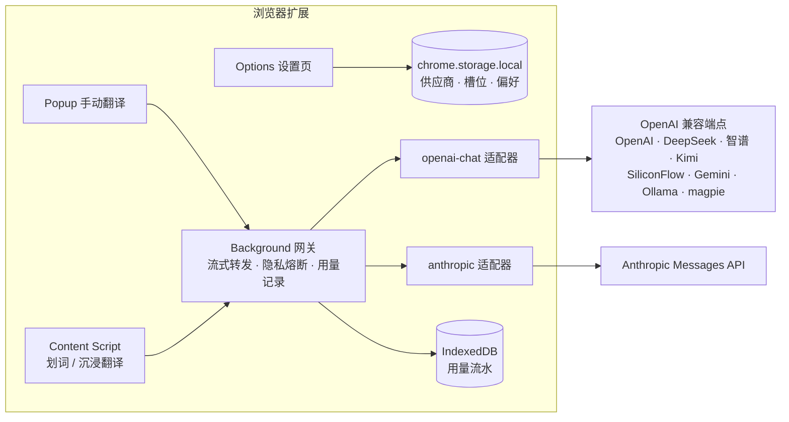

<div align="center">

# ✨ Better Translate

**AI 原生浏览器翻译扩展 —— 上下文感知的划词翻译与沉浸式网页翻译，模型管理透明可控**

[](https://github.com/Planckbaka/better-translate/actions/workflows/ci.yml)
[](https://github.com/Planckbaka/better-translate/releases)
[](LICENSE)
[](CONTRIBUTING.md)
[](https://github.com/Planckbaka/better-translate/stargazers)

[简体中文](README.md) | [English](README.en-US.md)

</div>

---

Better Translate 把 **LLM 当作翻译引擎本身**，而不是传统翻译服务之上的附加项。它直面现有翻译工具的三大痛点：

1. **上下文断裂** —— 逐段独立翻译导致术语前后不一致、代词错译（[沉浸式翻译 issue #164](https://github.com/immersive-translate/immersive-translate/issues/164)）
2. **模型不透明** —— AI 能力绑会员、自带 Key 配置繁琐、花费无法预估
3. **交互打扰** —— 划词弹窗误触发、翻译按钮不出现、打断阅读流

模型管理部分借鉴 [magpie](https://github.com/yetone) 的设计：多供应商注册表、组合路由键、按功能分配模型、failover 模型组与逐请求用量流水。

## ✨ 特性

### 已实现（v0.2.0）

- **划词 AI**：选中文本浮现「译」字浮钮（或直接展开面板），`Alt+T` / 双击 / 右键菜单触发；**译文 / 解释 / 原文**三 Tab 流式面板，解释页含词义、词性、搭配与例句
- **上下文感知**：自动携带页面标题与选区前后文参与翻译，一词多义不再译错
- **「重译」**：对译文不满意，一键换「单段重译」槽位的强模型重跑
- **站点规则**：按站点禁用/启用划词，支持通配子域
- **🔗 多供应商管理** —— 内置智谱 GLM / DeepSeek / OpenAI / Anthropic Claude / Google Gemini / Moonshot Kimi / SiliconFlow / Ollama 预设，以及任意 OpenAI 兼容自定义端点（one-api、new-api、**本机 magpie 网关**均可直连）
- **🎯 按功能分配模型** —— 划词、解释、整页、重译四个槽位各绑一个模型，轻活用「快」档、硬骨头用「强」档
- **⚡ 流式翻译** —— Popup 手动翻译框，SSE 流式渲染，⌘/Ctrl + Enter 即译
- **📊 用量与成本可观测** —— 每次请求记录 tokens / TTFT / 耗时 / 估算成本，按日、按模型聚合
- **🔒 隐私模式** —— 一键只允许本地模型端点（127.0.0.1 / localhost），公共云模型全部熔断
- **🧪 一键连通测试 / 模型目录拉取** —— 填完 Key 即刻验证，支持从 `/models` 自动发现模型

### 规划中

- 沉浸式网页翻译：双语对照 / 仅译文替换 / 悬停浮层三种模式，批处理与滚动渐进翻译（M2）
- 页面级术语表与上下文预热，解决术语一致性（M2）
- 模型组 failover、配额展示（M3）
- 生词本、翻译历史、自定义 Prompt（M4）

完整路线图见[下文](#-路线图)。

## 📊 与主流方案对比

| 能力 | Better Translate | 沉浸式翻译 | 划词翻译 | Google 翻译 |
| --- | --- | --- | --- | --- |
| LLM 上下文感知（标题 / 前后句） | ✅ | ⚠️ 逐段独立 | ⚠️ 仅选区 | ❌ |
| 页面级术语一致性 | 📋 规划中 | ❌ | ❌ | ❌ |
| AI 词义解释 / 例句学习 | ✅ | ❌ | ❌ | ❌ |
| 多供应商自带 Key | ✅ | ✅ | ✅ | ❌ |
| 按功能分配不同模型 | ✅ | ⚠️ | ❌ | ❌ |
| 模型组 failover | 📋 规划中 | ❌ | ❌ | ❌ |
| 用量 / 成本统计 | ✅ | ⚠️ | ⚠️ | ❌ |
| 隐私模式（仅本地模型） | ✅ | ⚠️ | ❌ | ❌ |
| 开源免费 | ✅ MIT | ❌ 订阅制 | ❌ | ❌ |

> 对比基于公开信息与社区反馈整理（截至 2026-10），如有出入以各产品官方为准。

## 🚀 快速开始

### 方式一：下载安装包

从 [Releases](https://github.com/Planckbaka/better-translate/releases) 下载最新 `better-translate-*.zip` 并解压。

### 方式二：从源码构建

```bash
git clone https://github.com/Planckbaka/better-translate.git
cd better-translate
pnpm install
pnpm build
# 产物在 apps/extension/.output/chrome-mv3/
```

### 加载扩展（Chrome / Edge）

1. 打开 `chrome://extensions`
2. 右上角开启「开发者模式」
3. 「加载已解压的扩展程序」→ 选择 `apps/extension/.output/chrome-mv3` 目录

### 配置模型

1. 点击工具栏的 Better Translate 图标 → **设置**
2. **模型供应商** → 「+ 添加供应商」→ 选择预设（推荐智谱 `glm-4.5-flash`，有免费额度）或填自定义端点
3. 粘贴 API Key（页面提供申请入口链接）→ 点击 **测试** 确认连通
4. 第一个供应商的模型会自动填入各功能槽位，开箱即用

> 💡 本机跑着 [magpie](https://github.com/yetone)？添加「自定义端点」，Base URL 填 magpie 的本地 OpenAI 兼容地址即可复用你的全部模型配置。

## 🧠 模型管理

```
provider/model 组合路由键
├─ provider   供应商注册表：preset 模板 · 多协议端点 · off 开关 · key 申请引导
├─ model      模型元数据：上下文窗口 · 视觉/推理能力 · 速度档 · 单价
├─ slots      功能槽位：selection / explain / page / retryStrong 各指一个路由
└─ usage      逐请求流水：tokens · ttft · 耗时 · 估算成本 → 按日聚合
```



## 🔒 隐私设计

- **默认最小发送**：只发送你选中的文本（及可关闭的页面标题），从不发送 URL
- **隐私模式**：全局开关只允许本地端点，云模型请求直接拒绝而非降级
- **本地存储**：所有配置与 API Key 仅存于浏览器本地（`chrome.storage.local`），无任何遥测上报
- **请求透明**：用量流水可随时查看每一次请求的去向与开销

## 🗺️ 路线图

| 里程碑 | 内容 | 状态 |
| --- | --- | --- |
| M0 | 模型供应商管理 + Popup 手动翻译 + 用量统计 | ✅ v0.1.0 |
| M1 | 划词 AI：触发系统、译文/解释/原文流式面板、上下文携带、站点规则 | ✅ v0.2.0 |
| M2 | 沉浸式网页翻译：智能分段、批处理协议、双语/替换/悬停三模式、SPA 增量、双层缓存、术语预热 | 📋 |
| M3 | 模型组 failover、模型目录发现、配额展示、页面粘性路由 | 📋 |
| M4 | 生词本、术语表注入、翻译历史、自定义 Prompt 与风格 | 📋 |
| M5 | PDF 阅读、输入框划词替换、TTS 朗读、Edge / Firefox | 📋 |

## 🛠️ 开发

| 命令 | 说明 |
| --- | --- |
| `pnpm dev` | 启动 WXT 开发模式（自动拉起 Chrome 并热更新） |
| `pnpm build` | 生产构建（Chrome MV3） |
| `pnpm zip` | 打包发布 zip |
| `pnpm test` | 运行 Vitest 单测 |
| `pnpm typecheck` | TypeScript 严格类型检查 |
| `pnpm lint` | Biome 代码检查 |
| `pnpm lint:fix` | 自动修复格式与可修复问题 |

**环境要求**：Node.js ≥ 20、pnpm ≥ 9（`corepack enable`）。

```
packages/
├─ shared/      领域模型：Provider / ModelMeta / Slots / UsageRecord / preset 目录 / 价格表
├─ providers/   统一 LLM 适配层：openai-chat（兼容大多数网关）+ anthropic，SSE 增量解析
└─ core/        平台无关引擎：prompt 构建、语言检测（M2 起加入分段 / 批处理 / 路由）
apps/
└─ extension/   WXT + React：background 流式网关、popup、options、content script（M1）
```

欢迎参与贡献！请先阅读 [CONTRIBUTING.md](CONTRIBUTING.md)。

## ❤️ 致谢

- [magpie](https://github.com/yetone) —— 模型管理设计的灵感来源（provider 注册表 / 组合路由键 / 按功能分配 / 用量流水）
- [沉浸式翻译](https://immersivetranslate.com/) 与 [划词翻译](https://github.com/hcfyapp/crx-selection-translate) —— 验证了双语翻译与划词场景的价值，本项目的许多取舍源于对它们社区反馈的研究
- [WXT](https://wxt.dev/) —— 让浏览器扩展开发回归愉悦

## 📄 License

[MIT](LICENSE) © 2026 Planckbaka
